<div align="center">



<a href="https://github.com/Guilock">
  
</a>

<br/>

[](https://github.com/Guilock)
[](https://github.com/Guilock)
[](https://github.com/Guilock)

</div>

---

## `~/whoami`

```bash
guilock@lab:~$ whoami
guilherme

guilock@lab:~$ cat about.txt
> Building a career in cybersecurity, one lab at a time.
> Studying networks, Linux administration and pentesting fundamentals.
> Documenting everything I learn: notes, labs and write-ups.
> Background in payments & fintech systems (APIs, fiscal and card infrastructure).

guilock@lab:~$ ls focus/
networking/   linux/   security/   ctf/
```

---

## `01` / TECHNOLOGIES

<div align="center">

**SYSTEMS & SCRIPTING**


**DATA & INTEGRATION**


**SECURITY LABS**


**PAYMENTS & FINTECH BACKGROUND**


</div>

---

## `02` / AREAS OF INTEREST

<div align="center">

|  |  |  |
|:---:|:---:|:---:|
| Network protocols | System administration | Pentesting fundamentals |
| Network diagnostics | Permissions & services | CTFs & security labs |
| Infrastructure | Privilege escalation concepts | Vulnerability research |

</div>

---

## `03` / TOOLKIT

<div align="center">

**NETWORK ANALYSIS**


**CYBERSECURITY**


**OPERATING SYSTEMS**


</div>

---

## `04` / CURRENTLY LEARNING

<div align="center">


</div>

---

## `05` / PROJECTS

<div align="center">

| Repository | Description | Status |
|:---|:---|:---:|
| [`network-labs`](https://github.com/Guilock/network-labs) | Network topologies and experiments |  |
| [`linux-labs`](https://github.com/Guilock/linux-labs) | Linux administration and security |  |
| [`ctf-writeups`](https://github.com/Guilock/ctf-writeups) | CTF notes and technical documentation |  |
| [`homelab`](https://github.com/Guilock/homelab) | Home infrastructure and experiments |  |

</div>

---

## `06` / GITHUB STATS

<div align="center">


<br/>


</div>

---

## `07` / CONTACT

<div align="center">

[](mailto:SEU-EMAIL@exemplo.com)

</div>

---

<div align="center">

```bash
$ echo "BUILD · TEST · LEARN · DOCUMENT"
```


</div>
